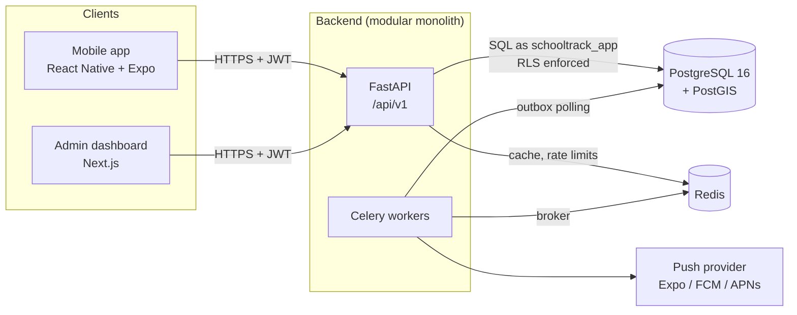

# Architecture overview

## Context



The API and the workers ship from the same codebase and container image but
run as separate processes. This is the modular monolith from ADR-001.

## Backend modules

```
backend/app/
├── api/              HTTP layer: routers, dependencies, error handlers
├── core/             configuration, security primitives, logging
├── infrastructure/   database engine and sessions, Redis, external clients
├── modules/          business modules (added when implemented)
│   ├── identity/       users, auth, roles, devices
│   ├── institutions/   institutions, campuses, people, classrooms
│   ├── geolocation/    geofences, spatial validation, accuracy rules
│   ├── attendance/     events, state machine, records, excuses
│   ├── notifications/
│   ├── analytics/
│   └── audit/
└── workers/          Celery app and tasks
```

Each module is organized as `router.py → service.py → repository.py`, plus
`models.py` (SQLAlchemy) and `schemas.py` (Pydantic). The module boundaries
follow these rules:

- A module calls another module only through that module's service. It
  never imports another module's repository or touches its tables.
- Cross-module side effects (attendance → notification) go through domain
  events written to an outbox table in the same transaction (ADR-005).
- `core` and `infrastructure` depend on no business module.

Modules are created when they get their first real feature. The Week 1
skeleton deliberately contains only `api`, `core` and `infrastructure`.

## Request lifecycle (tenant-scoped endpoint)

```mermaid
sequenceDiagram
    participant C as Client
    participant A as FastAPI dependency chain
    participant S as Service
    participant D as PostgreSQL

    C->>A: request + Bearer JWT (+ X-Institution-Id hint)
    A->>A: verify JWT → user_id
    A->>D: BEGIN; SET LOCAL app.current_user_id
    A->>D: load active membership + roles for hinted institution
    alt no active membership
        A-->>C: 403 (the hint is never trusted on its own)
    end
    A->>D: SET LOCAL app.current_institution_id
    A->>S: call with TenantContext(user, institution, roles)
    S->>D: queries (RLS filters by tenant)
    S-->>A: result
    A->>D: COMMIT
    A-->>C: response
```

The client may *say* which institution it is working in, because a user can
belong to several. The backend only uses that value after checking that the
authenticated user has an active membership there.

## Attendance write path (target design, Week 4)

1. Validate the request: request age, location age, accuracy, idempotency
   key.
2. If the idempotency key already exists, return the stored event.
3. Run the geofence check in PostGIS: `ST_Covers` against the campus's active
   geofences, plus the distance to the nearest edge.
4. `SELECT … FOR UPDATE` the subject's state row, check the transition, then
   insert the event and update the state, all in one transaction.
5. Write the outbox row for notifications in the same transaction.

## Deployment (local)

`docker compose up` starts `db` (PostGIS), `redis`, `migrate` (a one-shot
Alembic upgrade) and `api`. Workers, the web dashboard and the mobile dev
server are added in the weeks that need them.

## Key risks

| Risk | Impact | Mitigation |
|---|---|---|
| RLS misconfigured (missing policy, API running as owner or superuser) | Cross-tenant data leak | Separate runtime role; `FORCE RLS`; tests that list every tenant table and check that it has a policy |
| GPS spoofing | False attendance | Defence in depth: accuracy and age thresholds, mock flags, movement plausibility, review queue. Documented as a limitation, not solved |
| Poor GPS indoors (accuracy > 30 m) | Legitimate users rejected | Thresholds are configurable per institution; flag for review instead of rejecting outright; manual fallback |
| Client clock skew | Events rejected for request age | Store both clocks; tolerance window; server time endpoint |
| Burst at school opening | Latency, lock contention | Lock per subject only; load test in Week 7 |
| Minors' personal data (Law 1581) | Legal exposure | Data minimization, guardian authorization, retention limits, legal review before real use |
