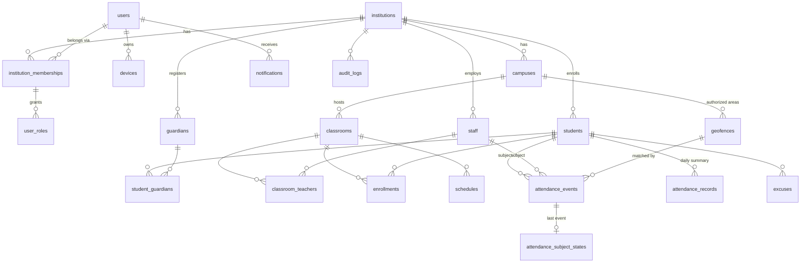

# Database design

The reviewed SQL is in [`schema.sql`](schema.sql). This page explains the
decisions behind it. From Week 2 onward the schema is implemented through
Alembic migrations; this design is the reference those migrations follow.

## Entity overview

## Global vs tenant-owned tables

| Scope | Tables | Why |
|---|---|---|
| Global | `users`, `devices`, `platform_admins` | One person can belong to several institutions (a teacher at two schools, a guardian with children in different schools). |
| Tenant root | `institutions` | The tenant itself; RLS filters by `id`. |
| Tenant-owned | everything else | Carry `institution_id NOT NULL` and an RLS policy. |

`audit_logs.institution_id` is nullable: platform-level actions (creating an
institution) have no tenant and are visible only to the platform role.

## Differences from the initial entity list

The project brief listed 18 entities. The design keeps all of them and adds
four, each for a concrete reason:

- **`institution_memberships`**: `user_roles` references a membership with
  a composite foreign key, so a role cannot exist in an institution the user
  does not belong to, and suspending a membership suspends all its roles.
- **`platform_admins`**: Super Admin is a platform role. Modelling it as an
  institution role would need a nullable `institution_id`, which breaks both
  RLS and the composite keys.
- **`classroom_teachers`**: the brief says teachers manage *assigned*
  classes; that assignment needs its own table.
- **`attendance_subject_states`**: one row per person with their current
  state. The attendance service locks it with `SELECT … FOR UPDATE`, so two
  concurrent check-ins for the same student are serialized and the state
  machine stays consistent without scanning event history (ADR-004, Week 4).

Teachers are rows in `staff` with `staff_type = 'TEACHER'` plus the `TEACHER`
role in `user_roles`. Students may exist without a user account (young
children), so `students.user_id` is nullable.

## Tenant isolation, in layers

1. **Application**: the backend resolves the institution from the
   authenticated user's active memberships and never trusts an
   `institution_id` sent by the client (ADR-002).
2. **Session context**: each request transaction runs
   `SET LOCAL app.current_institution_id = …` (and `app.current_user_id`).
   `SET LOCAL` disappears at commit or rollback, so a pooled connection
   cannot leak one tenant's context into the next request.
3. **Row-Level Security**: every tenant table has `ENABLE` and `FORCE ROW
   LEVEL SECURITY` with a `USING` + `WITH CHECK` policy. A missing context
   evaluates to `NULL` and returns no rows (fail closed).
4. **Composite foreign keys**: PostgreSQL runs foreign-key checks without
   RLS. Without composite keys, tenant A could create a geofence pointing at
   tenant B's campus as long as it knew the UUID. With
   `(institution_id, campus_id) → campuses(institution_id, id)` the database
   rejects it.
5. **Least-privilege role**: the API connects as `schooltrack_app` (no
   superuser, no `BYPASSRLS`, not a table owner). Migrations run as the owner
   role.

Before a tenant is chosen (login, `GET /institutions`) only
`app.current_user_id` is set. Read-only policies then let users see their own
memberships, roles and institutions, and nothing else.

### Validation done in Week 1

The schema was loaded into PostgreSQL 16, with the PostGIS columns replaced by
`bytea` because PostGIS isn't installed in the authoring environment. An SQL
smoke test then checked, as `schooltrack_app`:

- With no tenant context, tenant tables return 0 rows.
- With tenant A's context, only tenant A's students and institution are
  visible.
- With only the user context, a user sees just their own membership and
  institution.
- Inserting a row for tenant B while in tenant A's context fails with an RLS
  error.
- Creating a geofence that points at tenant B's campus fails on the
  composite foreign key.
- Updating tenant B's student while in tenant A's context affects 0 rows.
- Changing `attendance_events.event_type` after insert is rejected, while
  changing `validation_status` is allowed.
- Reusing an idempotency key fails with a unique violation.

In Week 2 these checks become automated pytest tenant-isolation tests that run
against real PostGIS in CI.

## Attendance data

- **`attendance_events`** is the immutable fact log. A trigger allows
  updates only to `validation_status` and `validation_reasons` (the review
  workflow) and blocks deletes. Corrections are new events or manual entries
  with a mandatory `manual_reason`, each recorded in `audit_logs`.
- Exactly one subject per event: `CHECK (num_nonnulls(student_id,
  staff_id) = 1)`. The *actor* (who submitted) is stored separately, so a
  teacher's manual entry is distinguishable from a student's own check-in.
- `state_before` and `state_after` are stored on the event. History is then
  self-describing, and a replay can verify the state machine.
- `occurred_at` (client clock) and `received_at` (server clock) are both
  kept. The validator compares them against the configured maximum request
  age.
- Idempotency: `UNIQUE (institution_id, actor_user_id, idempotency_key)`.
  A retry returns the original event instead of creating a duplicate.
- Validation status is independent of attendance state, as the brief
  requires.
- **`attendance_records`** is a derived daily summary. It can be recomputed
  from events, schedules and excuses at any time.

## Geospatial data

- `geofences.area` is `GEOGRAPHY(POLYGON, 4326)` with a GiST index.
  Geography computes distances in metres on the ellipsoid, which matters for
  the 100 m radius and 30 m accuracy rules.
- `attendance_events.location` is `GEOGRAPHY(POINT, 4326)`. It is stored
  only when the user performs an attendance action; there is no tracking
  table.
- The containment check (`ST_Covers` plus an accuracy-aware buffer) and the
  choice between a polygon and a centre-plus-radius model are decided in
  ADR-003 (Week 3).

## Open questions

- **Location retention**: how long precise coordinates are kept before
  being reduced to the `geofence_result` alone. Proposed: 90 days, pending
  legal review under Law 1581.
- **Staff attendance and guardians**: staff attendance probably needs no
  guardian notifications, but this should be confirmed.
- **Academic periods**: `classrooms.academic_period` is free text for now.
  A dedicated table is needed if institutions have overlapping calendars.
